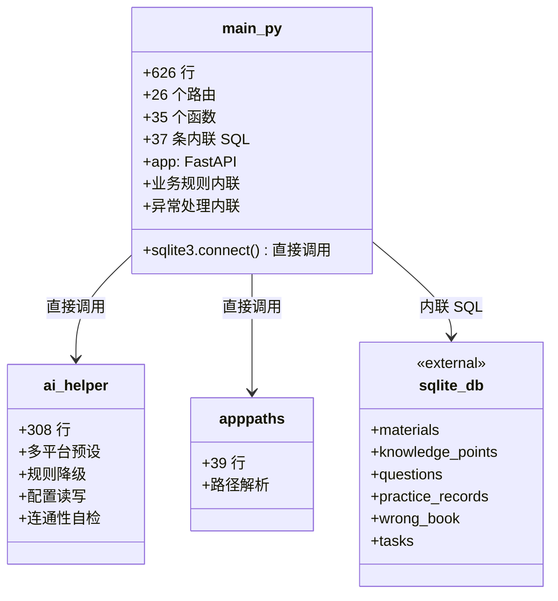
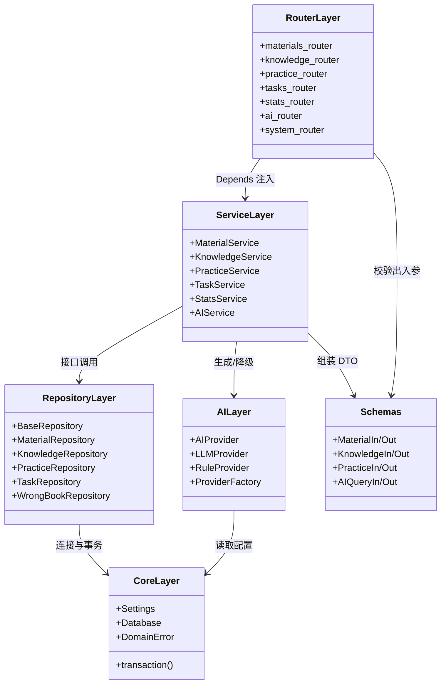

# v2 重构方案（分层架构 + 设计模式）

> 适用范围：`ai-learning-assistant` 后端。前端不在本次重构范围（保持接口契约不变）。
> 原则：**行为不变、接口不变**，只改内部结构。所有阶段结束后 `pytest` 必须全绿。

---

## 1. 重构目标

| 目标 | 对应评分点 |
|---|---|
| 消除上帝模块，形成可描述的分层架构 | 软件设计质量 |
| 用 UML 前后对比证明重构收益 | 设计文档 / 答辩 |
| 用可量化指标（行数、扇入扇出、测试覆盖）证明收益 | 量化对比 |
| 保持 26 个接口行为完全一致 | 功能完整性 |
| 让第二个人能独立改一块代码而不冲突 | 团队协作 |

---

## 2. 现状诊断（实测数据）

| 文件 | 行数 | 实际承担职责 |
|---|---:|---|
| `backend/app/main.py` | **626** | FastAPI 应用创建 + 26 个路由 + 35 个函数 + **37 条内联 SQL** + 业务规则 + 错误处理 + 静态文件挂载 |
| `backend/app/ai_helper.py` | 308 | 多平台适配 + 规则降级 + 配置读写 + 连通性自检（6 类职责） |
| `backend/app/apppaths.py` | 39 | 路径解析（唯一职责清晰的模块） |
| `backend/launcher.py` | 61 | 端口探测 + 启动浏览器 |
| `backend/tests/test_core.py` | 253 | 29 个测试 |

前端参考：`AiAssistant.vue` 237 行，其余视图 57–104 行。

### 关键问题

1. **上帝模块**：626 行单文件里 26 个路由直接 `sqlite3.connect` 拿游标写 SQL，没有任何数据访问层。
2. **无事务边界**：一次请求里多条写操作没有显式事务，异常时可能半写。
3. **配置硬编码**：路径、端口、表结构散落在模块级常量与函数体内。
4. **异常处理重复**：每个路由自己拼 `HTTPException`，错误码与文案不成体系。
5. **不可替换**：AI 引擎、存储、配置三件事耦合在路由函数里，换存储等于重写。
6. **测试只能走 HTTP**：没有纯单元测试的切入点，29 个测试全部依赖 TestClient。

---

## 3. 目标架构

```
backend/app/
├── main.py                  # 仅：创建 app、注册路由、挂载静态文件（目标 <60 行）
├── core/
│   ├── config.py            # Pydantic Settings，唯一配置入口（环境变量 + .env）
│   ├── database.py          # 连接工厂 + 事务上下文管理器
│   ├── exceptions.py        # 领域异常 + 全局异常处理器
│   └── dependencies.py      # FastAPI 依赖注入装配
├── domain/
│   ├── models.py            # 领域实体（dataclass / Pydantic）
│   └── enums.py             # 状态枚举
├── schemas/                 # 请求/响应 DTO（Pydantic）
│   ├── material.py  knowledge.py  practice.py  task.py  ai.py
├── repositories/            # 数据访问层：只碰 SQL
│   ├── base.py              # BaseRepository（CRUD 模板方法）
│   ├── material_repo.py  knowledge_repo.py
│   ├── practice_repo.py  task_repo.py  wrong_repo.py
├── services/                # 业务规则层：只碰仓储接口
│   ├── material_service.py  knowledge_service.py
│   ├── practice_service.py  task_service.py
│   ├── stats_service.py     # 学习统计/薄弱点分析
│   └── ai_service.py        # 组装 Prompt、调用 Provider、降级
├── ai/
│   ├── base.py              # AIProvider 抽象基类
│   ├── providers.py         # OpenAI 兼容 / 规则引擎 两个实现
│   ├── factory.py           # ProviderFactory（按配置选实现）
│   └── prompts.py           # Prompt 模板集中管理
└── api/
    └── routers/
        ├── materials.py  knowledge.py  practice.py
        ├── tasks.py  stats.py  ai.py  system.py
```

**依赖方向（单向，禁止反向）**：

```
api ──> services ──> repositories ──> core/database
                └──> ai ──> core/config
schemas 被 api 与 services 共享；domain 被所有人依赖，自己不依赖任何层
```

---

## 4. 设计模式落点

| 模式 | 落点 | 解决的问题 |
|---|---|---|
| **Repository（仓储）** | `repositories/*` | SQL 从路由里彻底剥离，换存储只改这一层 |
| **Unit of Work / 事务上下文** | `core/database.py` 的 `transaction()` | 多写操作要么全成要么全回滚 |
| **Strategy（策略）** | `ai/providers.py`（LLM 实现 / 规则引擎实现） | 有无 API Key 自动切换，行为可替换 |
| **Factory（工厂）** | `ai/factory.py` | 按配置装配 Provider，调用方不关心实现 |
| **Dependency Injection** | `core/dependencies.py` + FastAPI `Depends` | 服务与仓储可注入、可在测试中替换为内存实现 |
| **DTO / Schema** | `schemas/*` | 请求响应契约显式化，非法输入在边界被拦 |
| **Template Method** | `repositories/base.py` | 增删改查骨架复用，子类只写差异 |
| **全局异常处理器** | `core/exceptions.py` | 错误码统一，路由里不再重复 `try/except` |

---

## 5. 重构前 UML



问题一眼可见：`main_py` 同时依赖展示、业务、数据、外部 AI 四类职责，扇出为 3、扇入为 0，改动任何一处都要动它。

---

## 6. 重构后 UML



每个类只依赖相邻下一层，`main.py` 退化为装配点。

---

## 7. 分阶段实施计划

| 阶段 | 内容 | 验收标准 |
|---|---|---|
| **P0 基线固化** | 冻结当前 26 个接口的请求/响应样本（快照测试），确保重构期间契约不变 | `pytest` 29 项全绿 + 契约快照生成 |
| **P1 骨架落地** | 建 `core/`（Settings、Database、事务、异常）+ `schemas/`，`main.py` 接入但路由逻辑暂不动 | 应用可启动，测试仍全绿 |
| **P2 数据层剥离** | 37 条 SQL 全部迁入 `repositories/`，路由改为调用仓储 | `main.py` 中 SQL 数量降为 0 |
| **P3 业务层剥离** | 统计、薄弱点、任务状态流转等规则迁入 `services/`；路由只做参数校验与调用 | 单个路由函数 ≤ 15 行 |
| **P4 AI 层策略化** | `ai_helper.py` 拆为 `ai/`（基类 + 两个实现 + 工厂 + Prompt） | 有无 Key 两条路径均通过测试 |
| **P5 收尾** | 依赖注入装配、全局异常处理、补单元测试（脱离 HTTP） | 单元测试 ≥ 15 个，`main.py` ≤ 60 行 |

**每个阶段单独一个 commit，可单独回滚。**

---

## 8. 量化指标对比（重构前后）

| 指标 | 重构前（实测） | 重构后（目标） |
|---|---:|---:|
| `main.py` 行数 | 626 | ≤ 60 |
| `main.py` 中路由数 | 26 | 0（迁至 routers） |
| `main.py` 中内联 SQL 条数 | 37 | 0 |
| 后端模块数（app 下） | 3 | ≥ 22 |
| 最大单文件行数 | 626 | ≤ 200 |
| 平均单文件行数 | — | ≤ 120 |
| 纯单元测试数（不依赖 HTTP） | 0 | ≥ 15 |
| 抽象基类 / 接口数 | 0 | ≥ 2（AIProvider、BaseRepository） |
| 设计模式应用数 | 0 | ≥ 5 |
| 循环依赖 | 无检测 | 0（单向依赖） |

> 重构后用 `python scripts/count_lines.py` 与 `pytest --cov` 重新生成实测值，替换本表"目标"列，作为报告中的对比数据。

---

## 9. 风险评估与回滚

| 风险 | 影响 | 对策 |
|---|---|---|
| 接口行为漂移 | 前端页面报错 | P0 契约快照测试作为护栏 |
| 事务改造引入锁 | 并发写阻塞 | SQLite 用 `BEGIN IMMEDIATE`，连接按请求创建 |
| 一次性改动过大 | 难以定位回归 | 按 P1–P5 分阶段提交，每阶段测试全绿才继续 |
| 分支出错 | 主干被污染 | 全部在 `refactor-v2` 分支开发，PR 合并前跑 CI |

---

## 10. 分工建议

- **韦俊鑫**：P1 骨架、P2 仓储、P4 AI 策略化、P5 装配
- **黄吉航**：P3 业务层（任务/统计）、契约快照测试、重构后文档与 UML 复核

两人各改各的文件，除 `main.py` 外几乎不产生冲突——这正是分层带来的协作收益，可在报告中作为论据。
